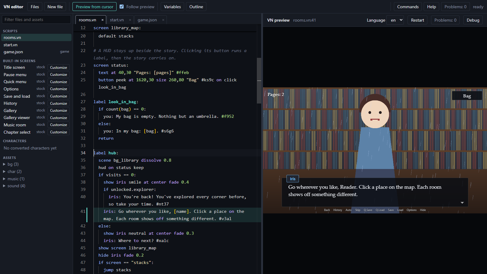

# Marginalia VN Engine (v0.1)

- These couple of paragraphs are the only content I type manually in to this project:
- This is a very much vibe-coded project over the current weekend (starting on 2026-10-31) born out of frustration of having tried to work with some of the existing engines. This has been very much prompted to alive from fundamentals, but no doubt the claude has borrowed many of the concepts and syntax from Renpy in particular. This project has specific workflows in mind and is not yet fully finished or tested thoroughly. UX experience is not expected to be particularly great from two days of development.

--

TypeScript visual novel engine with its own script language, an editor with a hot-reloading live preview,
localization, a PSD art pipeline and a web export. The engine core has no dependencies; the preview uses
PixiJS, the editor Monaco and the art pipeline ag-psd (dev dependencies, no bundler).



**The editor is the main way to work.** Save a script and the game reloads on the line you were on, Ctrl+Enter plays from
any line, Ctrl+P jumps to files, labels and assets, and panels show your variables live and draw the story as a flowchart
([a tour with screenshots](docs/tutorial/00-the-editor.md), shown on the demo project).

This repo is the engine plus a small sample game (`sample/`). Real games live in their own folders and
repos and use the engine as a package (see "Making a game").

## Run it (engine repo)

```
npm install
npm run dev          # builds, watches, serves http://localhost:5173 (editor: /editor/) for sample/
npm test             # engine and shell tests (node:test, no browser needed)
npm run test:browser # the browser tests (system Edge/Chrome); test:all runs both
npm run ids          # add localization ids (#abcd) to new dialogue/menu lines
npm run strings      # export locale/en.json, report gaps in other languages
npm run playtest     # play every route: unreachable lines, endings, unused assets and variables
npm run art          # convert changed PSDs in masters/ to assets/ (--force: all; npm run dev also watches)
npm run export       # static web build in sample/build/web (upload it, or zip it for itch.io)
```

Edit `sample/script/park.vn` while the preview is open: it reloads and returns to the line you were on.
Editing engine code (`engine/src`, `preview/`, `editor/`) rebuilds and reloads the page automatically.

## Making a game

```
node path/to/marginalia-vn/bin/vn.mjs init ../MyGame --title "My Game"
cd ../MyGame
npm install          # links the engine: "marginalia-vn": "file:../marginalia-vn" in package.json
npm run dev          # same editor and preview, on this project
```

The game folder holds only content: `game.json`, `script/`, `locale/`, `assets/`, `masters/` (Git LFS) and
`build/` (ignored). Its npm scripts call the `vn` command (`vn dev | export | art | ids | strings`), which
runs the engine's tools on the current folder. Because the dependency is a link, not a copy, engine changes
apply to the game right away; restart `npm run dev` after pulling engine changes. To freeze the engine for a
release, point the dependency at a tag (`"marginalia-vn": "git+file:../marginalia-vn#v0.1.0"`) and update it on
purpose. game.json `"engine": "0.1"` makes the tools warn when the engine is older than the game expects.

## Layout

```
engine/src/   expr, text, parser, compile, runtime, locale, ids, assets   (no DOM, runs anywhere)
engine/test/  node:test suite
preview/      dev-server.mjs (static + /api/project + live reload), index.html, preview.ts (game shell), saves.ts, blips.ts,
              stage-ui.ts (HTML text box, skip/auto), pixi-renderer.ts (world, WebGL), audio.ts (Web Audio),
              menus.ts (title/pause/options/saves/history), settings.ts, theme.ts (game.json theme -> CSS),
              storage.ts (per-game storage: browser or desktop files), input.ts (keyboard/gamepad navigation), timeline.ts (rollback history)
editor/       Monaco scene editor with the live preview beside it; palette.ts (Ctrl+P), help-dialog.ts (F1), asset-viewer.ts
tools/        paths.mjs (engine vs project folder), vn-tool.mjs (ids, strings), psd-convert.mjs (art pipeline),
              export-web.mjs, project-data.mjs
bin/vn.mjs    the vn command
sample/       the sample game: script/ (*.vn scenes), locale/ (<lang>.json), game.json (menus, theme, gallery),
              masters/ (big PSDs, Git LFS), assets/ (game-ready art and audio)
```

## Script syntax

A quick overview; every command with examples is in [docs/commands.md](docs/commands.md), and
`sample/script/demo.vn` demonstrates input, flash, tint, camera, weather, filters and text tags (open it in the editor and use
Preview from cursor, since park.vn owns the `start` label). `sample/script/animations.vn` is a tour of every
animation feature: put the cursor on its `label animation_showcase:` line and press Ctrl+Enter.

```
define alice "Alice" color=#ff6fa5      # character; optional style (see "Look and feel")
set trust = 0                           # top-level lines run once before the story starts
label start:                            # entry point is "start" (or the first label)
  scene bg_park fade 0.5                # transitions: cut | fade | dissolve | wipe <left|right|up|down> | iris | blinds | pixelate
  music play theme loop  /  music stop fade 1  /  music pause  /  music resume
  show alice smile at left fade 0.3     # pose, at left|center|right|0-1|a game.json position, layer=variant overrides
  show alice smile at 0.35 y=0.02 scale=1.1 flip=on   # place without a slide (the animation studio's Place row writes it)
  move alice to right 0.6 ease=out      # ease: linear | in | out | inout | back | bounce | elastic ; add `nowait` to run in background
  move alice scale=1.2 rot=-5 y=-0.03 0.4   # size, tilt, lift, alpha=, flip=on|off, anchor=feet|center|head|0.5,0.3 (the pivot)
  shake alice 0.3 strength=6   hop alice 0.25   wait 0.5   sound play door duck   # duck: the music dips under it
  sound loop rain fade 2  /  sound stop rain fade 3   # looping ambience on its own channel (`sound stop` alone ends all)
  animate alice breathe loop  /  animate alice nod  /  animate alice stop   # breathe bob sway nod shiver pulse bounce hop shake, or a rig.json animation; part=hair moves one part
  flash [#ffffff] [0.4]                 # screen flash that fades out
  tint #203060 0.4 1.5  /  tint off      # colour wash over the scene: color, strength 0-1, seconds (lasts until `scene`)
  image show letter cg/letter at 960,540 anchor=center fade 0.4  /  image move letter to 960,300 0.5  /  image hide letter   # overlay pictures: assets/ path, stage pixels, layer=-1 behind characters, fixed, keep
  camera zoom 1.5 at left y=0.4 0.8 ease=out  /  camera pan right 1  /  camera reset 0.5   # zoom about a point, slide it, reset; resets on `scene`
  weather rain|snow|petals|embers [0.6] [1]  /  weather off      # falling particles: intensity 0-1, fade-in seconds
  filter blur|grayscale|sepia|night|vignette [1] [0.8]  /  filter off   # a look over the scene: strength 0-1, seconds
  nvl on  /  nvl clear  /  nvl off      # full-screen narration pages instead of the text box; a new page on clear or scene
  alice: Hello.{pause=0.4} [name]        # {i}{/i} {b}{/b} {pause=s}, [variable]
  alice: {color=#ff6fa5}Pink{/color}, {size=1.5}big{/size}, {wave}wavy{/wave}, {shake}shaky{/shake}, {ruby=kan}漢{/ruby}
  alice: Wait for it...{wait} there.{nw}   # {wait} stops until a click; {nw} goes on without one
  "Narration line."
  menu "Optional prompt line" timeout 8:   # timeout is optional: seconds to answer; needs the on timeout block below
    "Option" if trust >= 1:             # optional condition; add  else "Reason shown"  to show it disabled instead of hiding it
      set trust += 1
      jump other
    on timeout:                         # what happens when time runs out (Options can extend or remove the clock)
      jump caught
  if trust >= 2:  ...  elif ...:  ...  else:  ...
  input name "What's your name?" default="Alex" max=16   # asks the player; stores text in [name]
  screen map:  /  hotspot cafe at 300,300 size 360,200 "Cafe"  /  button back at 80,940 "Back"   # declare a page
  column at 80,200 gap 20: / row anchor topright: / grid 3:   # inside a screen: place buttons without pixel maths
  show screen map as place              # waits; the chosen element's id is stored in [place]
  screen options:  /  slider master at 700,300  /  button text_sounds at 700,400 "Sounds: [text_sounds]" action cycle   # replaces the stock options (also `screen title`, `pause`, `quickmenu`); `action tab` switches the variable `tab`
  hud on status  /  hud off status      # a screen that stays up while the story runs; its `on click label` elements call that label; `hover "img.png"` on a hotspot swaps in art while it is hovered
  define item key "Brass key"           # name for list entries (set bag += "key")
  call helper  /  return  /  jump label  /  end
  label shop(item, cost):  /  call shop("sword", 10)   # parameters are local to the call (restored at return); arguments are expressions
  unlock good_ending                     # persistent flag (all playthroughs); read it as unlocked.good_ending
  if unlocked.good_ending:  ...
  set persistent.deaths += 1             # persistent number/text/boolean (all playthroughs); read it as persistent.deaths
  set roll = random(1, 6)  /  set line = pick("Hi", "Hey")  /  if chance(30):  ...   # seeded; replays identically on load and rollback
  set bag = []  /  set bag += "key"  /  if contains(bag, "key"):  ...   # lists: contains, count, item, index, pick(list)
```

Lines get a trailing id like `#a3f9` (menu options: `"text" #a3f9:`). `npm run ids` adds them.
The script is the source language; other languages live in `locale/<lang>.json` as `{ "a3f9": "..." }`.

## Design notes

- The runtime is a deterministic state machine (pc, call stack, variables, display state).
  Hot reload = replay in instant mode to the source line, then continue live.
- `Renderer` (engine/src/types.ts) is the seam. The world (backgrounds, sprites, transitions, effects) is
  drawn with PixiJS and needs WebGL; text, menus and the quick menu are HTML over the canvas (stage-ui.ts).
- The stage is 1920x1080 unless game.json sets `"stage": {"width", "height"}` (e.g. 1080x1920 for a portrait game); see
  docs/game-json.md. The size is read from game.json on every run and is never stored in saves.
- Art reaches the Pixi renderer through `assets/`; anything missing is drawn as a placeholder, and changed
  files hot-reload. Hand-made images work too: `assets/bg/<name>.png|webp|jpg`, and
  `assets/char/<char>/<pose>.png|webp` (pose `default` when omitted) for unlayered characters.
- Loading: nothing is fetched at boot except the title screen's background and music. `attachPreloads` (engine/src/assets.ts)
  walks the story's control flow (jumps, calls with their returns, every menu option, both sides of an `if`) and
  attaches preload tasks to the program start, every label, line, menu and input: the images and audio met within
  the next 40 lines, nearest first. The shell (`prefetch` in stage-ui.ts) loads them four at a time, so a scene's
  background and sprites are usually ready long before it is shown, and the first scene loads behind the title screen.
  A `scene`, `show` or `music` whose files are not ready yet holds until they are (a loading bar appears after
  a quarter of a second) instead of drawing a placeholder; skipping cannot outrun this. Restoring a save, rolling back
  and hot reload load the final state's files before drawing it. Not seen by the walk and loaded anyway: `blip=`
  samples and the default layers of a `show` without a pose; gallery backgrounds are fetched by the gallery.
  Nothing is unloaded yet. Details and measurements: docs/asset-loading.md.

## Game shell: title screen, options, audio

Opening http://localhost:5173 shows the title screen (New game / Continue / Load / Options). The preview inside
the editor skips it. While playing, **Esc** or right-click opens the pause menu (Resume / Save / Load / Options /
Main menu); Esc and Back always return to the previous screen.

- `game.json` sets up the title screen and menus (every option: [docs/game-json.md](docs/game-json.md)). Edit it in the editor's **game.json** tab, which offers
  completions (scene and track names from the script and assets), hover help and validation. Press
  Ctrl+Enter in that tab (or a row under **Built-in screens** in the Files panel) shows the title in the preview; edits then appear live.
  JSON with syntax errors is not saved.
  ```json
  { "title": "Evening in the Park",
    "titleScreen": { "background": "bg_park_evening", "music": "evening_theme", "showTitle": true,
                     "align": "center", "buttons": ["new_game", "continue", "options"] },
    "labels": { "new_game": "Begin" },
    "theme": { "accent": "#5fd1c3", "font": "Georgia" } }
  ```
  `intro` names a script label played as a cutscene before the title screen (Esc skips). `splash` lists logo cards shown once at start (click skips); `titleScreen.fade` is the black fade between title and game.
  `buttons` sets order and visibility; `labels` overrides menu text in the source language; `theme.font`
  applies to story text and menus.
- Quick menu (while playing): Back, History, Auto, Skip, Q.Save, Q.Load, Save, Load, Options, Hide.
  Hotkeys: wheel up / Page Up = back, wheel down = advance, L = history, A = auto, Tab = skip (or hold Ctrl),
  F5 / F9 = quick save / load, H or middle click = hide the interface. Which buttons show, in what order,
  and where: `"quickMenu": { "items": [...], "position": "bottom" | "top", "align": "left" | "center" | "right" }`.
- Keyboard and gamepad: in any menu, or at a choice, the arrow keys (or d-pad / left stick) move between
  buttons, sliders and selects (Left/Right changes a slider or select, or switches the Options tab when a tab is
  focused), Enter / Space (A) presses, Esc (B) goes back, and Tab moves focus as usual at a choice. Numbers 1-9
  still pick a choice. While playing, a gamepad uses A / d-pad down or right = advance, d-pad up or LB = back,
  X = auto, Y = hide the interface, Select = history, B or Start = pause menu, hold RB = skip. Inside menus LB /
  RB switch the Options tab. Name prompts (`input`) show an on-screen keyboard while a pad is the last thing used (a key press or
  click hides it again): A types the focused key, X is backspace, Y is shift, and A on the text field presses OK. The mapping is `PadMapper` in preview/input.ts (standard-layout pads).
- Back (rollback) returns to the previous line or choice exactly, and lets you choose differently. It
  replays to that step (`Runtime.restore({ step })`). Saves carry the last 150 steps, so Back and History
  also reach past a load, unless the script changed since the save (then they start at the loaded line).
- Skip fast-forwards through lines read before (in any playthrough, kept per browser) and stops at choices
  and at unread text; Options can make it skip everything. Auto's speed is in Options; A toggles it.
- Saves: 9 pages x 6 slots plus an autosave (written on every line, page "A" in Load). Each slot shows a
  thumbnail, the time and the line on screen; overwriting, deleting and loading mid-game ask first.
  Load also has the quick save page ("Q") and a "C" page with the last 5 choice autosaves (game.json `"choiceSaves"`, 1-20), written whenever a
  choice or name prompt appears, so players can return to just before a decision.
  Continue loads the newest save of any kind. A save stores the source position and the choices made, not
  engine internals, so saves keep working after the script is edited (preview/saves.ts).
- Options: master/music/sound volume, text speed (up to instant), auto speed, text sounds, skip read/all text,
  text size, text box opacity, reduce motion, language, fullscreen, grouped in Audio, Game and Accessibility tabs. Saved per browser in localStorage.
  Reduce motion (on by default when the system asks for it) drops shake, hop, flash and weather, makes wipes, iris, blinds and pixelate dissolves,
  snaps `camera` and stops wavy/shaking text. Box opacity fades the default box; a `theme` background or
  image keeps its own look.
- Audio: `music play <name>` plays `assets/music/<name>.ogg|mp3|wav|m4a|flac|opus`, and `sound play <name>`
  plays `assets/sound/<name>.*`. Music crossfades over `fade n`, keeps playing through hot reloads when the
  track is unchanged, and loops only with `loop`. `music pause`/`resume` hold and continue it, `sound loop`/`sound stop`
  run ambience beside it, and `sound play ... duck` dips the music under a sound. Cues without a file show as text in
  the corner.
- Voice lines: a recording named after a line's localization id, `assets/voice/<id>.ogg|mp3|wav|m4a|flac|opus` (or
  `assets/voice/<lang>/<id>.*` for the player's language, which wins), plays when the line appears; no script command is
  needed. Auto-advance waits for it to finish, advancing or skipping cuts it. Players get a Voice volume slider, a
  Voice button on the quick bar (only on voiced lines) and key `V` to hear the line again.
- Menu labels translate through `ui.<key>` entries in `locale/<lang>.json` (keys: the `data-ui` attributes
  in preview/index.html, e.g. `"ui.new_game": "Uusi peli"`). `npm run strings` leaves them alone.

## Persistent flags and the gallery

`unlock <flag>` stores a flag for good (endings reached, extras, achievements); conditions read it as
`unlocked.<flag>`. A playthrough sees the flags as they were when it started plus its own unlocks, and saves
remember that starting set, so loading or rolling back always replays the same branches; new unlocks are
stored immediately anyway. The compiler warns about a flag that is read but never unlocked.

`set persistent.<name> = ...` does the same for numbers, text and true/false (counters, names, route progress); read
it as `persistent.<name>` (or `[persistent.<name>]` in text). Same start-plus-own-changes rule, saved with each save;
the compiler warns about a value that is read but never written. "Reset player data" clears it too.

The dev preview's **Debug** button opens a console (not in exported games). `vars` lists the running story's variables,
`set <name> = <expr>` changes one now, a bare expression such as `trust + 1` prints its value, `jump <label>` starts a new
playthrough there, `unlock <flag>` / `lock <flag>` edit the flags, and `reset <gallery|music|chapters|flags|options|persistent|seen|saves|progress|all>`
clears what persists (`progress` is everything but saves). `help` lists them; Up/Down recall earlier commands.

## Randomness

`random(a, b)`, `random(n)`, `random()`, `pick(a, b, ...)` and `chance(percent)` work in any expression. They draw
from a seeded generator whose state is part of the runtime state (seed kept in saves, rewound on every restore), so
load, rollback and hot reload replay the same draws and branches; see docs/commands.md.

game.json `"gallery"` lists images; a Gallery button appears on the title screen (keep `"gallery"` in
`titleScreen.buttons`). An entry unlocks once its background has been shown while playing, or by a flag:

```json
"gallery": [
  { "image": "cg_park_kiss", "title": "Under the lamps" },
  { "image": "cg_epilogue", "title": "Epilogue", "unlock": "good_ending" }
]
```

The viewer shows one image at a time (arrow keys to browse, click or Esc to close).

Extras work the same way: `"musicRoom"` lists tracks (unlocked once they have played) and `"chapters"` lists script
labels (unlocked once reached; picking one starts a new playthrough there). Each gets a title-screen button
(`"music_room"` and `"chapters"` in `titleScreen.buttons`); see docs/game-json.md.

## Playtest bot

`npm run playtest` (`vn playtest` in a game project; the editor's **Story: Playtest All Routes** command does the same
on the unsaved scripts) plays the compiled story by itself, taking every menu option and every screen element, and
reports:

- the **endings** it reaches (`end`, a `return` with nothing to return to, or running off the end of the scripts), each
  with the shortest route of choices that gets there and the flags (`unlock`) that route sets;
- **lines and labels no route reaches** (a branch whose condition never holds, an option that can never be offered);
- **possible endless loops** (a path that runs thousands of lines without a choice or an end) and screens that wait
  for a pick but offer nothing to pick;
- **variables** set but never read, or read but never set; `unlock` flags nothing checks;
- **unused assets**: images, music and sounds no script, screen, item or game.json names. Layers of a layered
  character count as used once the character is shown.

In the editor the unreachable lines, loops and unused variables also show up as problems (F8) until the next edit.

Options: `--strict` (exit code 1 when anything is found, for CI), `--json`, `--all-labels` (also start from every
label nothing jumps to, such as scenes you enter with Preview from cursor; the editor always does), `--label <name>`
(start from that label too, repeatable), `--max-states <n>` and `--seeds <n>`. game.json's `intro` and `chapters`
labels are always played too.

How it works, and what it does not do: it steps the compiled program like the runtime does and forks at each choice.
A situation met twice (same place, call stack, variables, flags) is explored once, so loops end when they stop
changing anything. To keep counters from running forever, a number that is only ever compared with fixed numbers
counts as the same once it is a few steps beyond all of them; variables no condition can see are ignored; lists
compare as sets (unless the story uses `item()`, `index()` or `count()`). Flags and persistent data left behind by one
playthrough are available to the next, so `unlocked.x` content gated on a first ending is found. Input answers are
the default text. A condition that draws a random number is followed both ways; other draws (`set x = random(3)`)
come from a seeded generator, and the search repeats with a few seeds. When the budget (`--max-states`) runs out the
report says INCOMPLETE and "unreachable" may be wrong. Hotspot and button `on click` handlers of a HUD are played from
the point the HUD went up. The bot cannot know what the player does in the shell (save, load, rollback) or what game.json
`intro`/`chapters` unlock conditions mean, and it treats assets named only in code it cannot see (a dynamic
`image "item_[n]"` is matched as a pattern) on a best-effort basis.

## Checking art and audio

The editor (and the preview's Problems list, and `npm run export`) warns about names with no matching file:
backgrounds, poses and slot variants of layered characters (from their sprite.json), single-image poses,
music and sounds, and the names game.json uses (title screen background and music, gallery and splash
images). Art folders with no files at all are treated as "not made yet" and stay quiet, so a prototype
running on placeholders shows no art warnings. Audio has no placeholder, so a missing track or sound is always
reported, as are blip voices and text box skins.

## Editor

http://localhost:5173/editor/ edits the scripts and game.json next to the live preview. **Ctrl+P** opens
the palette (it works with focus anywhere, including in the preview); what you type picks the mode.
The **Files** panel (button or Ctrl+B) lists the scripts, game.json, characters (click to open the rig.json) and
the assets by folder (click to view an image, play a sound or preview a font in a dialog; Left/Right step through the folder), with a filter box. Tabs close with their × (or middle-click,
or Alt+W); closing only hides the tab, the script still compiles with the rest. **Alt+1**, **Alt+2** and **Alt+3**
move focus to the editor, the preview (to play it with the keyboard) and the Files panel's filter, from anywhere; Monaco's
**Ctrl+M** makes Tab leave the script instead of indenting. F1 lists all the editor's keys under "Editor keys".

| Type | Mode |
|---|---|
| (nothing) | go to file; recently used first, so Ctrl+P, Enter flips between two files. A new name offers "Create" |
| `>` | commands: preview from cursor / title screen / new game, add ids (file or all), save all, next problem, toggle follow / word wrap / minimap / preview pane, export web build, open exported game, export strings, reconvert all art, reset player data, plus every Monaco editor action |
| `@` | go to label, across all scripts |
| `:` | go to line |
| `#` | go to asset: a character with a converted `sprite.json` opens its `rig.json` in a tab (a generated skeleton when it has none, unsaved until you save); other assets open in a viewer dialog |
| `?` | list the modes |

The rig.json tab (see Art pipeline) completes part, slot and variant names for that character, marks mistakes as
warnings, and saves like game.json. **Character: Update Rig from Reconverted Art** adds parts that are new in the
art to `order` and reports ones that are gone. `show alice ` completes rig.json shorthands and `slot=` names.

**F2** on a label name (its `label` line, a `jump`/`call`, an `on click|focus|blur`, or `intro`/`chapters` in game.json) renames the label and every reference to it in all scripts and game.json at once; a name that is invalid or already taken is refused. F2 on a variable name does the same for a story variable (`set`, conditions, `call` arguments, `[name]` in text, `input`, `show screen ... as`), and for `persistent.<name>`; a label parameter or a screen `each ... as` name is renamed only inside its label or loop, and a reserved word, a name the game fills in, or one that would merge with another variable is refused (translations in locale/*.json keep the old `[name]` until you re-export or edit them). **Ctrl+Shift+F** (Find and Replace in All Files) opens a panel that searches every script and game.json (match case, whole word, regexp with `$1` in the replacement), lists the hits (click one to go there) and replaces them all. The logic is in engine/src/refactor.ts and engine/src/var-refactor.ts.

Hex colors show a swatch in the editor, and clicking it opens a color picker that rewrites the value (`#rrggbb`, or `#rrggbbaa` when not opaque). In scripts that covers colors after `=` (`color=`, `text=`, `{color=#...}`) and after `tint` / `flash`; in game.json any quoted hex string (the `theme`). Named colors and `rgba(...)` get no swatch. The logic is in engine/src/colors.ts.

Preview from cursor also works on lines the story never reaches (a label nothing jumps to yet): the preview runs
the top-level setup, then plays that label from its start up to the line, so a `show` before it is on stage. When the
label skips the line (an `if` that is false) or never gets to it, the preview enters the code at the line itself.

A mistyped name (a command, a label, a character, a screen, or a background, pose, track, sound, animation or part
that has no file) is marked with the closest known names in the message, `Unknown command "shwo" (did you mean
"show"?)`, and **Ctrl+.** on it offers each one as a quick fix. The matching is in engine/src/suggest.ts. The **Variables** button (or the command) shows the
story variables, unlock flags and persistent values live while the preview plays; values that just changed are highlighted. Double-click
a variable to edit it (`true`/`false`, a number, or text; Enter applies, Esc cancels); persistent values are editable and stored at once, unlock flags are read-only.

The **Outline** button (or the command Story: Show Outline) draws the labels as a flowchart: jumps, calls and
labels that run on into the next one, with unreachable labels dashed. Click a label to go to its source.
Edges inside an `if` (or a choice with a condition) show the condition.
The mouse wheel zooms at the cursor, dragging pans (arrow keys and +/- too), **Fit** (or 0, or a double-click on
the background) shows everything and **Start** centres on the start label. The search box (or /) finds labels by
name, file or the text of a choice leading out of them; Enter steps through the matches. The layout and the pan/zoom
math are in engine/src/outline.ts.

**F1** (or the Help button) opens the command reference from docs/commands.md in a dialog, scrolled to the
statement under the cursor (a `{` in dialogue text opens the text tags); F1 or Esc closes it. In the game.json tab it
opens docs/game-json.md, and in a rig.json tab docs/rig-json.md at the key (`order`, `groups`, `poses`) the cursor is under.

Keys: Ctrl+Enter preview from cursor, Ctrl+S save, F8 / Shift+F8 next /
previous problem, Alt+Z word wrap. Commands are one list in `buildCommands()` (editor/editor.ts): a title,
an optional key (bound automatically and shown in the palette), an optional `when`, and `run`. Project tasks
(export, strings, art) run in the dev server (`/api/task`, a fixed whitelist) and stream to the Output panel, where
`file:line` references open that line.

## Look and feel

Characters: `define` takes style options after the name.

```
define alice "Alice" color=#ff6fa5 text=#ffe6f0 font="Georgia" size=1.1 italic speed=0.8 blip=blip_hi box=alice
define narrator "" text=#d8d2c0 italic   # style for "quoted narration" lines
define thought "" italic                 # thought: ... shows no name tag
```

`color` = name tag color, `text` = text color, `size` / `speed` = multipliers, `blip` = a text sound voice
(see below), `box` = a text box skin from game.json `theme.skins`.

**Text sounds (blips)** are optional sounds while a line types, like courtroom games. `blip=` takes a
built-in synthesized voice (`high`, `mid`, `low`, `soft`, `typewriter`, `robot`; no files needed), a voice
from game.json `"blips"`, or any `assets/sound/<name>` sample. `blip=none` silences a character. Players
can turn text sounds off in Options; they play on the Sound volume.

```json
"blips": {
  "alice":  { "synth": "square", "pitch": 760, "variation": 1, "every": 2 },
  "bob":    { "sound": "blip_bob", "interval": 70 },
  "kiki":   { "mode": "vowels", "vowels": { "a": "kiki_a", "e": "kiki_e", "i": "kiki_i", "o": "kiki_o", "u": "kiki_u" } },
  "droid":  { "synth": "sawtooth", "pitch": 150, "mode": "vowels" }
}
```

`mode`: `letters` (default) blips per letter; `vowels` blips only on vowels, each vowel at its own pitch or
with its own sample. `every` = every Nth letter, `interval` = minimum ms between blips (55), `variation` =
random pitch spread in semitones, `volume` 0-1, `length` = synth blip length in ms. Skipping and instant
text are silent.

game.json `theme` (all optional, pixels on the stage (1920x1080 by default, see game.json `stage`); the editor completes and checks it):

```json
"theme": {
  "accent": "#5fd1c3", "font": "Georgia",
  "textbox": { "x": 160, "y": 774, "width": 1600, "height": 250, "padding": [44, 56, 36, 56],
               "background": "rgba(10,13,19,.84)", "border": "#ffffff24", "radius": 8,
               "image": "textbox", "slice": 32 },
  "namebox": { "x": 40, "y": -26, "size": 34, "background": "#20252f" },
  "text":    { "size": 44, "color": "#e6e9ef", "lineHeight": 1.45 },
  "choices": { "width": 1000, "size": 40, "gap": 22, "radius": 8, "image": "button", "slice": 24 },
  "skins":   { "alice": { "textbox": { "image": "textbox_alice" }, "text": { "color": "#ffe6f0" } } }
}
```

`image` frames come from `masters/ui/<name>.psd` (converted 1:1 to `assets/ui/<name>.png`) and stretch as
9-slice: `slice` pixels of each edge keep their size. Fonts in `assets/fonts/` (woff2, woff, ttf, otf) can
be used by file name in `font` and in `define ... font=`.

## Exporting the game

`npm run export` builds the code, converts changed art, refuses to continue on script errors, and writes
`build/web/`: index.html, the engine and game shell, PixiJS, assets and a project.json. There is no dev bar,
editor or live reload. All URLs are relative, so it runs from any folder: upload it to a static host, or zip
the folder's contents for itch.io (HTML project, index.html at the root). Browsers do not run it from
file://; serve it, e.g. `npx serve build/web`.

`npm run export -- --desktop` instead writes an Electron app folder with packed, scrambled assets and saves
stored as files (see [docs/desktop.md](docs/desktop.md)).

Saves, settings and read-text tracking are stored per game under the game's id (game.json `"id"`, else a
slug of the title), so games on one site (itch.io serves all HTML games from one origin) don't collide.
Changing the id or title starts with fresh saves.

## Art pipeline (PSD masters)

```
masters/bg/<name>.psd     ->  assets/bg/<name>.png              (scene <name>) flattened, scaled to cover 1920x1080
masters/char/<char>.psd   ->  assets/char/<char>/sprite.json    + one trimmed PNG per part
masters/ui/<name>.psd     ->  assets/ui/<name>.png              (theme frames) flattened at 1:1
```

Character PSD layout (the canvas height becomes the 1080px stage height; keep the feet near the bottom):

```
eyes/                     top-level group = a slot
  smile, happy            a variant; extra names are poses that also pick it
  open, neutral, annoyed  the visible child is the slot's default
  closed
mouth/  ...
shading  (clipped)        top-level layers are always drawn; clipping masks merge into their base
+body/                    a "+" group is a folder, not a slot: its layers are drawn like top-level layers
  arms
  torso
body
_sketch                   names starting with _ (and hidden top-level layers) are skipped
```

`show alice smile` picks, per slot, the variant named or aliased `smile`, else the slot's default.
Z-order tweaks, groups and shorthands (full reference: [docs/rig-json.md](docs/rig-json.md), F1 in the rig.json tab) go in a hand-written `assets/char/<name>/rig.json` next to the generated
`sprite.json` (the converter never touches it); it is read when the game starts:

```json
{
  "order": ["body", "outfit_back", "hair", "outfit_front"],
  "groups": { "outfit": ["outfit_back", "outfit_front"] },
  "poses": { "shy": { "pose": "smile", "blush": "on" }, "casual": { "outfit": "casual" } }
}
```

`order` lists part names (a slot, or a plain layer's file name without `.png`) bottom to top; the listed parts
swap among the positions they already hold, the rest stay put. `outfit=school` sets every slot of the group
(a slot missing that variant is skipped with a warning). `show alice shy` expands to the pose plus overrides, and
`show alice shy blush=none` lets the line win over the shorthand. A slot named like a group wins over the group,
and a shorthand wins over a PSD layer of the same name.

The folder prefix is `"psdPrefix"` in game.json (default `"+"`, `""` turns folders off).
`show alice smile eyes=closed` overrides one slot; `glasses=none` empties one. A variant may be a group;
it is flattened (masks, clipping, opacity and common blend modes inside it are honoured). Layer effects are
not rendered, so rasterize them. Unknown poses and variants are reported in the preview's console.
Save backgrounds with "Maximize compatibility" so Photoshop's own composite is used.
- Preview-from-cursor replays from `start`, so it can only land on lines the story actually reaches.
- `window.postMessage({type:'goto', file, line})` jumps the preview to a line (hook for the future editor).

## License

Code: [MIT](LICENSE). The sample game's art (`sample/assets`, `sample/masters`) was generated by Claude (Anthropic).
