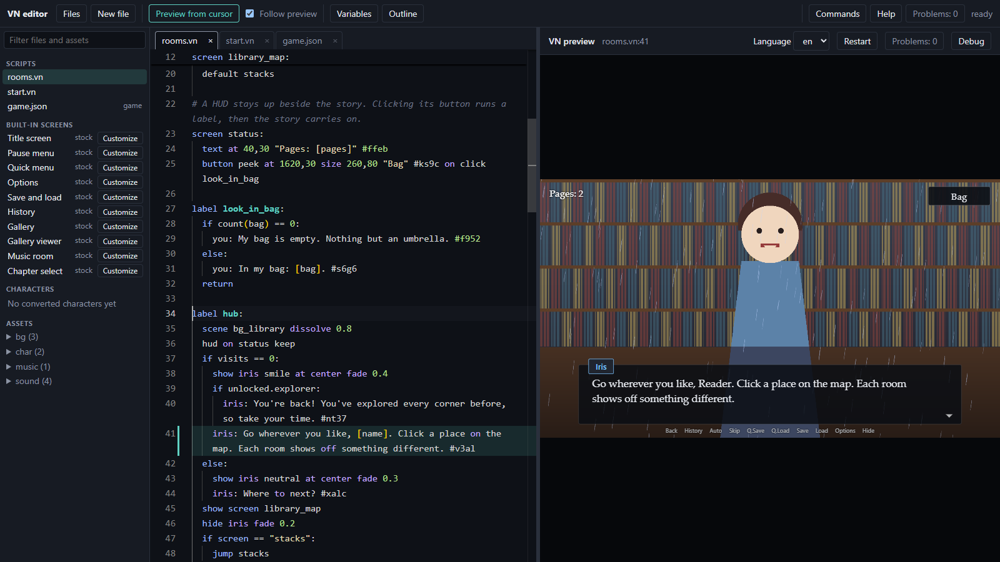
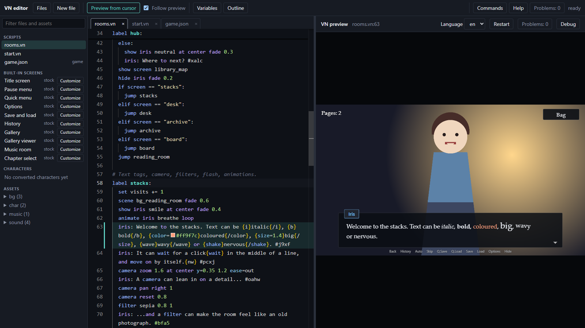
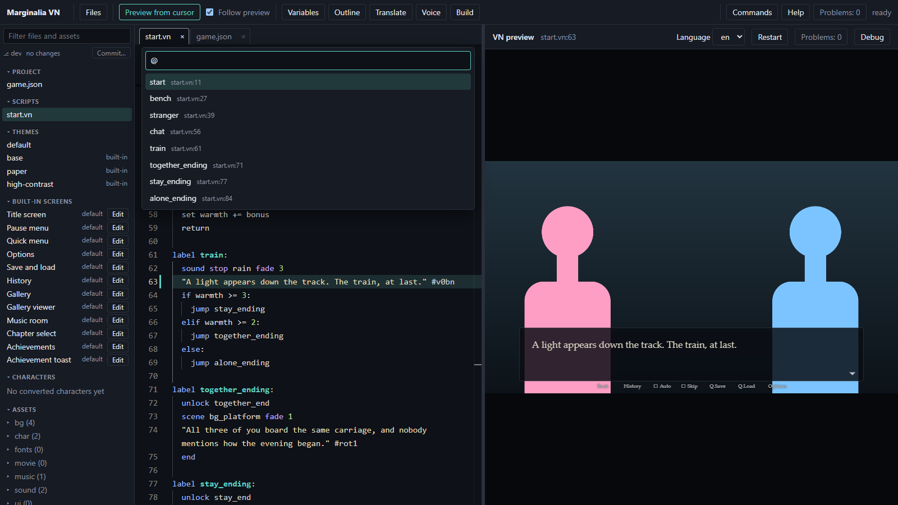
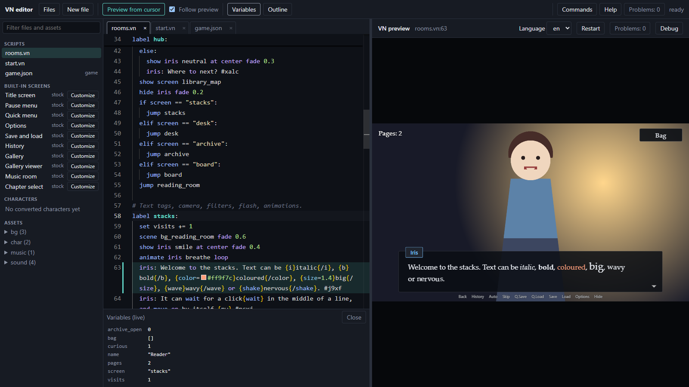
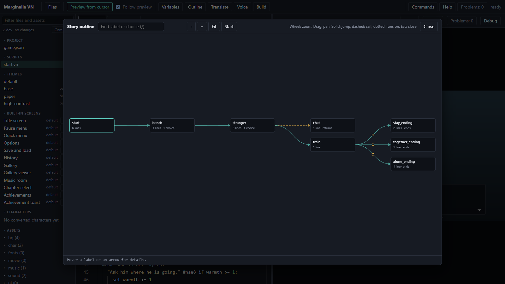
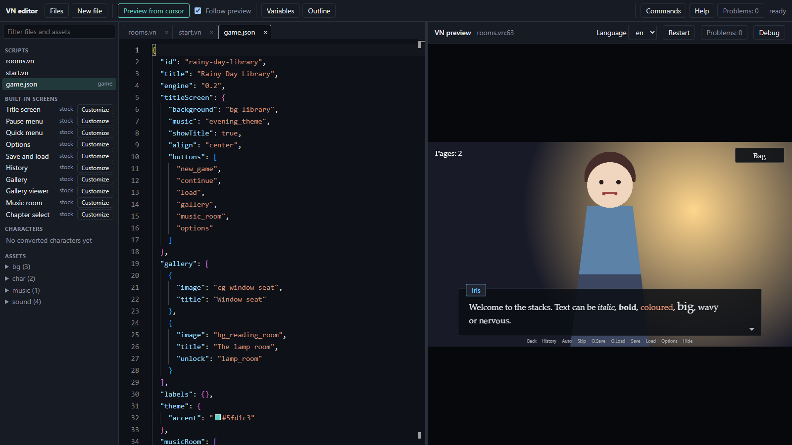

# The editor

`npm run dev` opens a browser editor made for visual novels: your script in the middle, the running game on the right
and the project's files on the left. You never need to leave it to write, test and fix a story. The screenshots show
the demo project.

## Write and see it at once

Save a script and the game reloads and returns to the line you were on. **Ctrl+Enter** (Preview from cursor) starts the
game from any line, even one the story never reaches yet, so you can test the last scene without playing through the
first ten. Completions, hover help and problem markers know your labels, characters, variables and asset names, and hex
colours show a swatch that opens a colour picker. A mistyped name is marked with the closest known ones
(`Unknown command "shwo" (did you mean "show"?)`), and **Ctrl+.** on it offers each as a quick fix.

## Jump anywhere with Ctrl+P

One palette does it all: type a file name, `@` for a label across all scripts, `:` for a line number, `#` for an asset,
or `>` for every command (add ids, build, playtest all routes, reconvert art, restore from trash and more). A file name
that does not exist yet offers to create it.

## See your variables live

**Variables** shows story variables, unlock flags and persistent values while the preview plays. Changed values are
highlighted, and a double-click edits one, handy for jumping straight to the branch that needs `trust >= 3`.

## The story as a flowchart

**Outline** draws every label with its jumps and calls, marks unreachable labels, and takes you to the source with a
click. Choices with conditions show the condition on the arrow. The wheel zooms, dragging pans, and the search box
finds a label by name or by the text of a choice that leads out of it.

## Files and assets

The **Files** panel (Ctrl+B) lists the project's `game.json`, the scripts, the built-in screens, characters and
assets. Click an image, a sound or a font to preview it, and drop files from your desktop onto the assets to copy
them into the project. A built-in screen says `default` until you press **Edit**, which writes a copy of its script into the
project for you to change; the demo's own pause menu in `menus.vn` shows up there in place of `default`.

Right-click a row for more (preview a script from its start, rename, delete, copy the path, reveal it in Explorer
or Finder). **F2** on a row renames or moves it, and renaming an asset also rewrites the scripts and `game.json` that
name it. Deleted and replaced files go to the project's trash: the message that follows has **Undo**, and
**Restore from Trash** in the palette brings back anything still there.

When the project is in a git repository, the top of the panel shows the branch and how many files changed.
**Commit…** saves your tabs, lists the changes, suggests a message and commits the project folder.

## Refactoring and help

**F2** on a name renames a label or variable everywhere at once, **Shift+F12** lists every use of one, and
**Ctrl+Shift+F** finds and replaces across all files. **F1** opens the command reference at the statement under the
cursor, and **F8** steps through problems. `game.json` has its own tab with completions and validation.

## Shipping

**Translate** edits translations side by side, **Voice** tracks a recording for each line, and **Build** runs the
pre-build checks and exports a web or desktop build into `build/`.

The full reference is in the [README's Editor section](../../README.md#editor).
