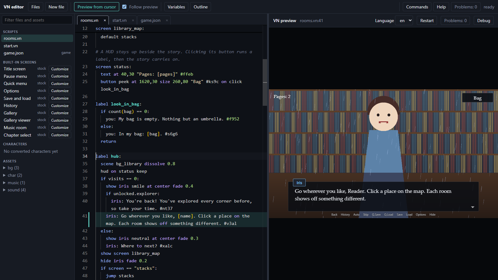
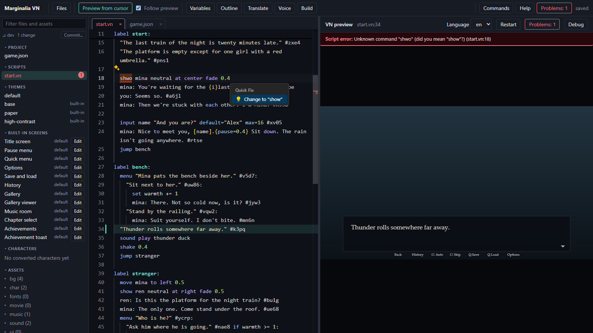
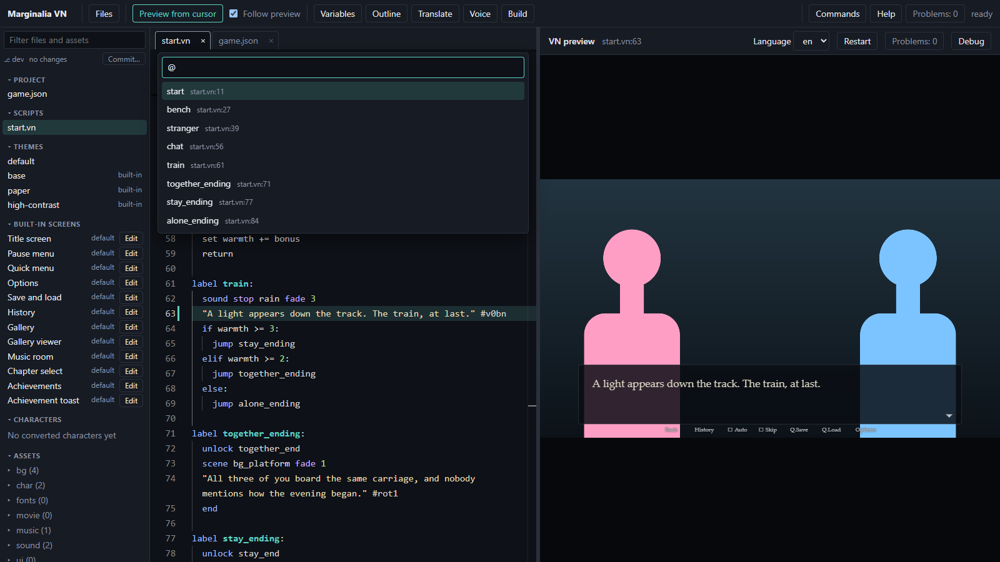

# 1. Your first scene

About ten minutes. By the end you will have changed a running game and seen the change at once.

You will build **The Last Train**, a short story about two strangers on a rainy platform. Pages 1 to 5 grow it from a
template into a game you can send to a friend. Its finished scripts are in `games/tutorial/`.

## Get an editor

Pick whichever is quickest:

- **In the browser, nothing to install:** open the [online demo](https://andynoumouse.github.io/marginalia-vn/)
  and start a project from a template there ([online demo notes](../online.md)).
- **Marginalia Studio (Windows):** run `Marginalia Studio.exe`, press **New project** and choose **Classic ADV**.
  There is no download yet; [studio.md](../studio.md) says how to build it.
- **From the command line** (needs Node.js 22 or newer and a clone of the engine, with `npm install` run in it once;
  the first `vn` command builds the engine, which takes a few seconds):

  ```bash
  node path/to/marginalia-vn/bin/vn.mjs init ../TheLastTrain --title "The Last Train" --template classic-adv
  cd ../TheLastTrain
  npm install
  npm run dev
  ```

  then open http://localhost:5173/editor/.

All three give you the same editor and the same project folder. Whichever you use, pick the **Classic ADV** template
(`--template classic-adv` on the command line): this tutorial reads and rewrites its script. Without a template you get
**Blank**, which has a different script and none of the characters used here.

## The editor in four parts

- **Middle: the script.** `script/start.vn` is open. The story is plain text.
- **Right: the game**, running. Click it, or press Space, to read on.
- **Left: Files.** The scripts, `game.json`, your characters and assets. Ctrl+B shows or hides it.
- **Red marks in the text.** Mistakes in the script are underlined as you type; F8 steps through them.



## Read the template's script

A script is a list of commands, one per line. Read the top of `start.vn` (shortened here: the real file has a few more
comments, a variable, a camera zoom and a choice):

```vn
# from the Classic ADV template
define narrator "" text=#d8d2c0
define mina "Mina" color=#ff9ec4 blip=high
define you "You" color=#7cc4ff blip=mid

label start:
  scene bg_title fade 0.5s
  music play evening_theme loop fade 1s
  "A quiet evening. Someone is waiting for you."
  show mina neutral at center fade 0.3s
  mina: You came. I wasn't sure you would.
  you: Sorry I'm late.
```

- `define` declares a character once. `color` tints the name, `blip` is the typing sound.
- `label start:` is where the story begins. Everything indented under it belongs to it.
- `scene` sets the background, `music play` starts a track, `show` puts a character on the stage.
- A line in quotes is narration. `name: words` is something a character says.
- A line that starts with `#` is a comment for you; the game ignores it.

## Change something

1. In the script, change Mina's first line to `mina: The train is late again.` There is nothing to save: the editor
   saves a moment after you stop typing (the tab's dot goes away), and the game reloads and returns to the line you were on.
2. Put the cursor on any line further down and press **Ctrl+Enter** (*Preview from cursor*). The game jumps to
   that line (it replays the story up to it in an instant), so you can test the end of a story without clicking
   through the beginning every time.
3. Misspell a command: change `show mina` to `shwo mina`. The line gets a red mark that says
   `Unknown command "shwo" (did you mean "show"?)`. Press **Ctrl+.** and choose the fix. (Undo the typo or accept
   the fix.) Pictures you have not made yet are not errors: a missing background or sprite is drawn as a
   placeholder, so you can write the story before the art exists. They do show as amber warnings, which page 3 clears.

   
4. Press **F1** on a command. The command reference opens at that command.



## Jump around with Ctrl+P

One box finds everything. Type a file name; `@` for a label in any script; `:` and a number for a line; `#` for an
asset; `>` for every editor command. You will use this all the time.

## Make it yours: the opening

Replace the template's `start` label with the opening of The Last Train. Do not worry about the extra commands, the
next pages explain them. Open `script/start.vn`, delete everything below the three `define` lines (the comments,
`set kindness = 0` and the rest of the story go too), and paste in the text below. The editor indents each new line for
you, so if you type it instead, leave out the leading spaces; **Shift+Tab** steps a line back to the margin where
`label` and `define` belong.

```vn
define ren "Ren" color=#9ec4ff blip=low

label start:
  scene bg_platform fade 0.8s
  music play evening_theme loop fade 2s
  sound loop rain fade 2s
  "The last train of the night is twenty minutes late."
  "The platform is empty except for one girl with a red umbrella."

  show mina neutral at center fade 0.4s
  mina: You're waiting for the {i}last{/i} train too?
  you: Seems so.
  mina: Then we're stuck with each other. I'm Mina.
```

Save. Mina walks on and the dialogue types out. `{i}...{/i}` italicises a word. Next to the game you can see the
speaker highlighted: *speaker focus*, switched on in `game.json`, dims whoever is not talking.

The template has no platform picture and no rain, so the background is a placeholder labelled `bg_platform`, the rain is
silent, and the **Problems** count in the top bar shows two amber warnings (`No background "bg_platform"`,
`No sound "rain"`). They are the files page 3 adds, not mistakes.

You now have the whole loop: **type, save, see it**. Everything else is more commands.

Next: [a story with choices](02-a-story-with-choices.md).
