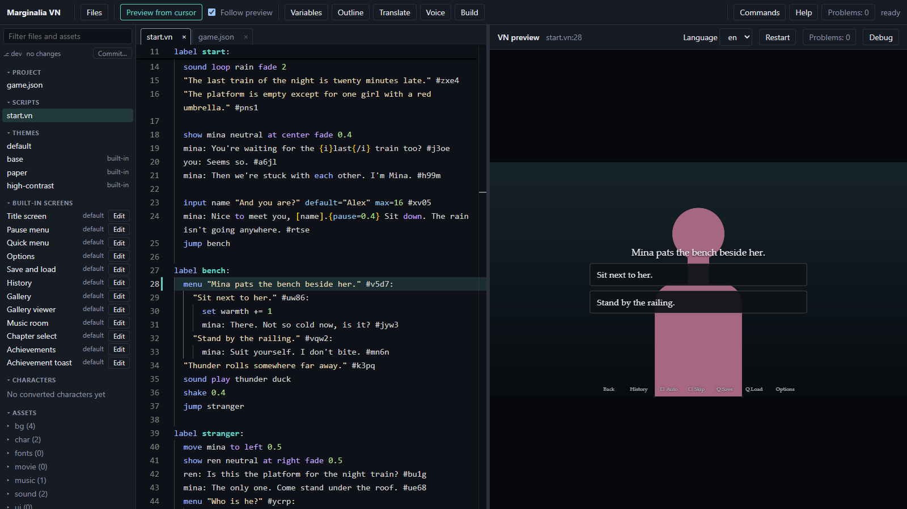
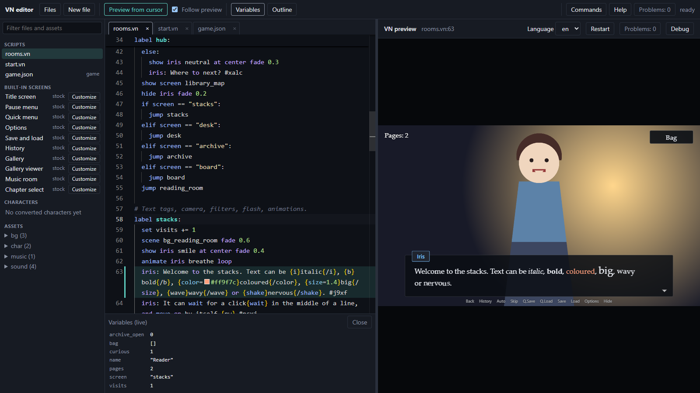
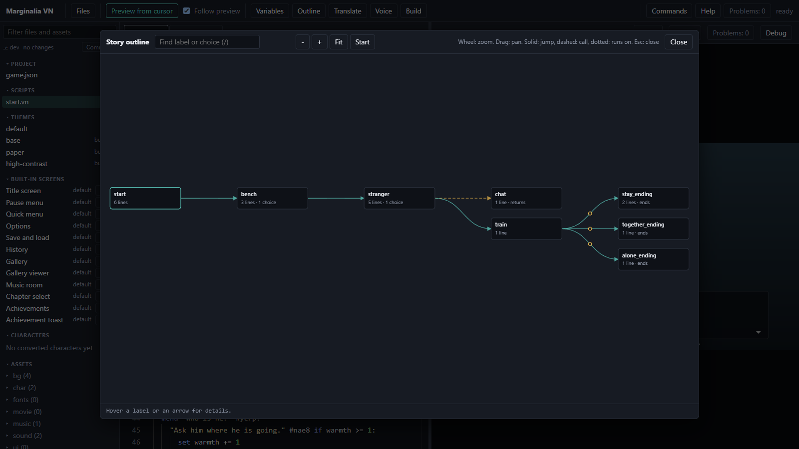

# 2. A story with choices

About thirty minutes. By the end The Last Train has three endings, a name the player typed, and a bot has checked
that every route reaches one.

You keep adding to `script/start.vn`. New labels go **below** the one before them, in the order of the headings; the
whole file is at the end of this page, so you can check yours against it.

## Ask for a name

At the end of `start`, after Mina introduces herself, add:

```vn
  input name "And you are?" default="Alex" max=16
  mina: Nice to meet you, [name].{pause=0.4s} Sit down. The rain isn't going anywhere.
```

`input` stores what the player typed in a variable, and `[name]` puts it into any line. `{pause=0.4s}` waits a
moment while the text types. (A list of every `{tag}` is in the [command reference](../commands.md#text-tags).)

## A choice

A `menu` shows options. Each option is a quoted line ending in `:` with an indented body. Add a new label, `bench`,
below `start`:

```vn
label bench:
  menu "Mina pats the bench beside her.":
    "Sit next to her.":
      set warmth += 1
      mina: There. Not so cold now, is it?
    "Stand by the railing.":
      mina: Suit yourself. I don't bite.
  "Thunder rolls somewhere far away."
  sound play thunder duck
  shake 0.4s
```

- `set warmth += 1` changes a variable. Create it first: above `label start:`, on a line of its own, add
  `set warmth = 0`. Lines at the top level of a file, outside any label, run once before the story starts.
- When the chosen body ends, the story carries on with the line after the `menu`.
- To go somewhere else, end the body with `jump <label>`. Labels are global across all scripts.
- `sound play thunder duck` plays a sound and dips the music under it; page 3 adds the file. `shake 0.4s` shakes the
  screen for 0.4 seconds.

Add `jump bench` as the last line of `start`, so the story reaches the new label. The game now stops at the choice:



## Conditions

An option can carry a condition. Two options may share the same text; only the ones whose condition holds are shown,
so the player who sat down with Mina gets the friendlier answer. A stranger arrives after the thunder: end `bench` with
`jump stranger`, and write his label below it:

```vn
label stranger:
  move mina to left 0.5s
  show ren neutral at right fade 0.5s
  ren: Is this the platform for the night train?
  mina: The only one. Come stand under the roof.
  menu "Who is he?":
    "Ask him where he is going." if warmth >= 1:
      set warmth += 1
      ren: Home. Eventually.
    "Ask him where he is going.":
      ren: Away from the rain, mostly.
    "Say nothing.":
      ren: Not much of a talker, then.
  jump train
```

`"Text" if cond else "Reason":` instead shows the option greyed out with a reason, and timed choices are covered in
[menu](../commands.md#menu--on).

`if`, `elif` and `else` do the same for lines. Add the label `jump train` goes to, below `stranger`:

```vn
label train:
  sound stop rain fade 3s
  "A light appears down the track. The train, at last."
  if warmth >= 3:
    jump stay_ending
  elif warmth >= 2:
    jump together_ending
  else:
    jump alone_ending
```

## Three endings

Each ending is a label that finishes with `end`. Write them below `train`:

```vn
label together_ending:
  unlock together_end
  scene bg_platform fade 1s
  "All three of you board the same carriage, and nobody mentions how the evening began."
  end
```

`unlock together_end` stores a flag for good. Page 4 turns the flags into achievements and a gallery picture.
Write `stay_ending` and `alone_ending` the same way, with the text from the whole script at the end of this page.

A label that ends without `jump`, `return` or `end` does not stop: the story carries on into whichever label is written
below it. The Outline (below) draws that as a dotted arrow. End every label on purpose.

## Reuse with `call`

A label can be run like a function. `call` runs it and `return` comes back, and parameters let one label serve many
cases. Write a subroutine between `stranger` and `train`:

```vn
# A subroutine: "call chat(...)" fills the parameters, "return" comes back.
label chat(who, bonus):
  "[who] and [name] swap stories while the rain falls."
  set warmth += bonus
  return
```

and call it from `stranger`, on the line just above `jump train`:

```vn
  call chat("Mina", 1)
```

The bonus from the chat is what lets a player who was kind all evening reach `stay_ending`.

## Watch the story as you write it

Three editor tools make branching manageable.

**Variables.** Open the **Variables** panel under the script while the preview runs. It shows `warmth` and `name`;
changed values are highlighted. Double-click the value next to `warmth`, type `3` and press Enter, and the story
takes the best ending when it reaches `train`.



**Preview from cursor.** Put the cursor inside `label train:` and press Ctrl+Enter. The game replays the story up to
that line, with the choices you made in the preview, so `warmth` holds what those choices gave it. To try another
branch, change `warmth` in the Variables panel once the preview is waiting there, then click on.

**Outline.** Open **Outline** to see every label as a flowchart, with the jumps between them. A label nothing can reach
is marked as unreachable. Click a box to jump to the source.



## Let the bot play every route

The **playtest bot** plays the story by itself, taking every option, and reports what it found. Run it from the
palette (Ctrl+P, then `>` and *Playtest All Routes*) or in a terminal:

```bash
npm run playtest
```

For The Last Train it reports three endings, each with the shortest route of choices that reaches it, and no
unreachable lines. If you delete the `if warmth >= 3` branch it tells you the "stay" ending can no longer be reached.
Run it whenever you change the shape of the story. More in [checks and tools](../checks-and-tools.md).

## The whole script

Your `script/start.vn` should now read like this, apart from small differences in wording and the localization ids
(`#ab12`) the editor adds to your lines. The `stay_ending` picture `cg_mina_end`, the thunder and the rain are
placeholders and silence until page 3:

```vn
# start.vn - "The Last Train", the game built in the tutorial.

define narrator "" text=#d8d2c0
define mina "Mina" color=#ff9ec4 blip=high
define ren "Ren" color=#9ec4ff blip=low
define you "You" color=#7cc4ff blip=mid

# Variables hold what the player has done; "if" and menu options can read them.
set warmth = 0

label start:
  scene bg_platform fade 0.8s
  music play evening_theme loop fade 2s
  sound loop rain fade 2s
  "The last train of the night is twenty minutes late."
  "The platform is empty except for one girl with a red umbrella."

  show mina neutral at center fade 0.4s
  mina: You're waiting for the {i}last{/i} train too?
  you: Seems so.
  mina: Then we're stuck with each other. I'm Mina.

  input name "And you are?" default="Alex" max=16
  mina: Nice to meet you, [name].{pause=0.4s} Sit down. The rain isn't going anywhere.
  jump bench

label bench:
  menu "Mina pats the bench beside her.":
    "Sit next to her.":
      set warmth += 1
      mina: There. Not so cold now, is it?
    "Stand by the railing.":
      mina: Suit yourself. I don't bite.
  "Thunder rolls somewhere far away."
  sound play thunder duck
  shake 0.4s
  jump stranger

label stranger:
  move mina to left 0.5s
  show ren neutral at right fade 0.5s
  ren: Is this the platform for the night train?
  mina: The only one. Come stand under the roof.
  menu "Who is he?":
    "Ask him where he is going." if warmth >= 1:
      set warmth += 1
      ren: Home. Eventually.
    "Ask him where he is going.":
      ren: Away from the rain, mostly.
    "Say nothing.":
      ren: Not much of a talker, then.
  call chat("Mina", 1)
  jump train

# A subroutine: "call chat(...)" fills the parameters, "return" comes back.
label chat(who, bonus):
  "[who] and [name] swap stories while the rain falls."
  set warmth += bonus
  return

label train:
  sound stop rain fade 3s
  "A light appears down the track. The train, at last."
  if warmth >= 3:
    jump stay_ending
  elif warmth >= 2:
    jump together_ending
  else:
    jump alone_ending

label together_ending:
  unlock together_end
  scene bg_platform fade 1s
  "All three of you board the same carriage, and nobody mentions how the evening began."
  end

label stay_ending:
  unlock stay_end
  scene cg_mina_end dissolve 1.5s
  mina: Let it go. We'll take the next one.
  "You stay on the bench, and the last train leaves without you."
  end

label alone_ending:
  unlock alone_end
  "You board alone and watch the platform shrink in the window."
  end
```

## What you made

A branching story with one typed answer, one variable, one conditional option and three endings, and a bot that
proves they are all reachable.

Next: [your own art and sound](03-your-own-art-and-sound.md).
