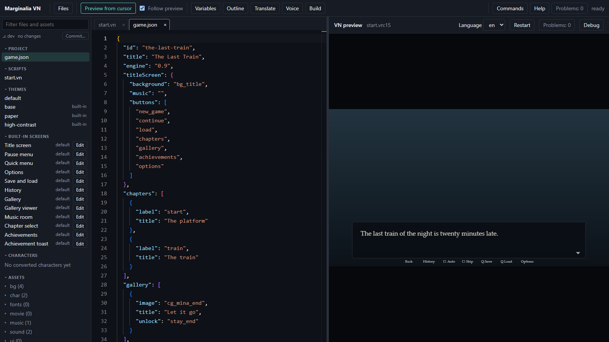

# 3. Your own art and sound

About twenty minutes. By the end The Last Train uses your own pictures and sounds instead of placeholders.

## Where files go

Everything the game shows or plays lives in `assets/`, in a folder per kind. The name you use in the script is the
file name without its extension.

| Folder | Holds | Used by |
|---|---|---|
| `assets/bg/` | backgrounds, 1920 x 1080 | `scene bg_platform` |
| `assets/char/<name>/` | one image per pose | `show mina neutral` |
| `assets/music/` | `.ogg` or `.mp3` | `music play evening_theme loop` |
| `assets/sound/` | short effects, ambience | `sound play thunder`, `sound loop rain` |
| `assets/ui/` | pictures for screens and themes | `screen` blocks and `game.json` |

A picture you name but have not made yet is drawn as a placeholder, so the story always runs. The pre-build checks
(page 5) tell you which files are still missing.

## Add a background

1. Open the **Files** panel (Ctrl+B).
2. Drag an image from your desktop onto **assets**. It is copied into the project, and a message names where it
   landed. Dropped on the **assets** heading, files are sorted by type: images go to `assets/bg/`, sounds to
   `assets/music/`, fonts to `assets/fonts/`. Dropped on a folder's own row, they go into that folder.
3. Name it for what it shows, such as `bg_platform.png`, in `assets/bg/`.
4. Use it: `scene bg_platform fade 0.8`.

Dragging is not the only way. Hover over the **assets** heading or a folder row and its icons appear: **Add files**
opens the file picker and **New folder** makes a folder, such as one for a new character.

Click an image, sound or font in the panel to preview it. To rename a file, press **F2** on its row: the scripts and
`game.json` that name it are rewritten for you. Deleted or replaced files go to the project's trash, and the message
that follows has **Undo**.



## Add characters with poses

Put one image per pose in a folder named for the character:

```
assets/char/mina/neutral.png
assets/char/mina/smile.png
assets/char/ren/neutral.png
```

then `show mina smile at center fade 0.3`. Show the character again with another pose name to swap the picture. Keep
the feet near the bottom of the image and use transparent PNGs. The template's silhouettes use the same names, so
you can paint over them.

A flat image per pose is the quick way. For a character whose eyes, mouth and clothes change independently, and
who can be animated, use a layered PSD: see [layered characters](deeper/d-layered-characters.md).

## Sound and music

Drop an `.ogg` or `.mp3` into `assets/music/` or `assets/sound/`. A sound dropped on the **assets** heading goes to
`music/`, so drop the rain and the thunder on the `sound` row instead (or press **F2** on the file and type the other folder in its name to move it).
The Last Train uses:

```vn
  music play evening_theme loop fade 2
  sound loop rain fade 2
  sound play thunder duck
  sound stop rain fade 3
```

- `music` crossfades over `fade` and repeats only with `loop`.
- `sound loop` starts an ambient sound on its own channel under the music; `sound stop` ends it. Looping sounds keep
  running across `scene`, so stop them yourself.
- `sound play ... duck` plays once and dips the music under it for the moment.

## Check what is missing or unused

The playtest from page 2 lists **unused assets** (files nothing names). The pre-build checks list the opposite, names
with no file. See [checks and tools](../checks-and-tools.md#checking-art-and-audio).

## What you made

The story plays with your backgrounds, sprites and sounds, and you know where each kind of file goes.

Next: [make it feel like a game](04-make-it-a-game.md).
