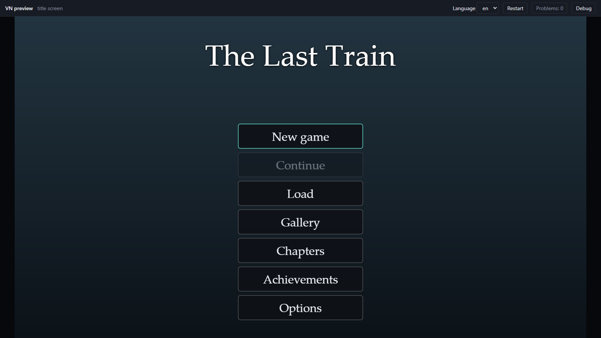

# 4. Make it feel like a game

About twenty minutes. A script that plays is a story; this page gives The Last Train a title screen, endings that are
remembered, and the things players expect from a visual novel.

## What you already have

Without writing anything, the game shell gives every project:

- a **title screen** with New game, Continue, Load and Options;
- **saves**: nine pages of slots, an autosave, quick save and load;
- **Back** (rollback) to the previous line or choice, and a **History** of read lines;
- **Skip** (read text only) and **Auto** advance;
- **Options**: text speed, volume, fullscreen, language;
- keyboard and gamepad control of every menu, and swipe gestures on a touch screen.

The template turns on a quick menu with buttons for these. Try them in the preview. Details are in the
[game shell](../game-shell.md).

## The title screen

It is configured in `game.json`, which has its own tab in the editor with completions and checks. The file is one JSON
object: each setting is a key such as `"titleScreen"` or `"gallery"`, with a comma after it unless it is the last.
A key can appear only once, so to change a setting that is already there, edit it rather than pasting a second copy
(the editor underlines a repeated key). Your project's `game.json` already has a `titleScreen`; give it two more buttons:

```json
"titleScreen": {
  "background": "bg_title",
  "music": "",
  "buttons": ["new_game", "continue", "load", "chapters", "gallery", "achievements", "options"]
},
```

`background` is a file in `assets/bg/`; `music` is a track in `assets/music/` (put `"evening_theme"` there to start
the title with it). `buttons` chooses and orders the buttons; leave one out and it is gone. A title screen can be
restyled or replaced completely: see [look and feel](../look-and-feel.md) and [game.json](../game-json.md).



## Remember the endings

You already wrote `unlock stay_end` and the other two. A flag stored with `unlock` lasts across playthroughs. Give
`game.json` a title and a description for each. This is a new key: add it as its own entry in the object, for example
on the line after `"gallery": [],` and with a comma after its closing bracket.

```json
"achievements": [
  { "unlock": "together_end", "title": "All aboard", "description": "Board the train together.", "ending": true },
  { "unlock": "stay_end", "title": "The next one", "description": "Let the last train go.", "ending": true },
  { "unlock": "alone_end", "title": "Window seat", "description": "Leave alone.", "ending": true }
],
```

When the ending is reached, a toast announces the achievement, and the **Achievements** screen lists all three. With
`"ending": true` they are also counted as endings. Play to an ending in the preview to see it.

A flag can unlock a **gallery** picture too, shown from the title screen. `game.json` already has `"gallery": []`;
put the entry between its brackets:

```json
"gallery": [
  { "image": "cg_mina_end", "title": "Let it go", "unlock": "stay_end" }
],
```

The picture is a file in `assets/bg/`. It shows locked until the player reaches that ending.

Flags are visible to the script as `unlocked.<name>`, so the story can notice what the player has already seen:

```vn
# extra: not in the finished game
if unlocked.stay_end:
  "You remember another night, and a train that left without you."
```

## Chapters

A chapter is a label the player can restart from. Another new key for `game.json`, which can go right after `achievements`:

```json
"chapters": [
  { "label": "start", "title": "The platform" },
  { "label": "train", "title": "The train" }
],
```

A chapter unlocks the first time the story enters its label. The **Chapters** button then lists the unlocked ones, and
picking one starts a new playthrough at that label with empty variables, so use it for scene replay and chapter
select.

## Remember across playthroughs

`unlock` is a yes-or-no. For a number or a piece of text that should outlive one run, use `persistent`:

```vn
# extra: not in the finished game
set persistent.rides += 1
if persistent.rides >= 3:
  "You have waited on this platform [persistent.rides] times."
```

## Try it on a phone

An exported game plays on a touch screen with no extra work: a tap advances, a swipe right rolls back a line, a swipe up opens
the history, and buttons are enlarged to a comfortable size. The `touch` section of
[game.json](../game-json.md#touch) turns the gestures off if your own screens need swipes. To make the whole game
portrait, start a project with `--stage 1080x1920` or the *Portrait* template.

## Make it look like yours

Colours, fonts and the text box are a **theme**: `themes/default.json` in your project. It already sets an accent
colour; change its value:

```json
{
  "extends": "base",
  "tokens": { "accent": "#e07a5f" }
}
```

The **Theme panel** (the button next to **Themes** in the Files panel) edits colours, fonts and the text box with a
live preview. See [look and feel](../look-and-feel.md) when you want more.

## What you made

A game with a title screen, three remembered endings, achievements, a gallery picture and chapters.

Next: [ship it](05-ship-it.md).
