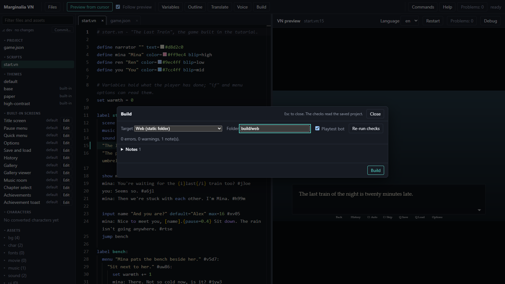

# 5. Ship it

About ten minutes. By the end you have a link or a zip file that someone else can play.

## Check before you build

The **Build** button in the editor (or *Build: Checks and Export* in the palette) saves your tabs and lists the
pre-build checks, grouped by severity, each with a link to the line:

- **Errors** block the build: a script that does not compile, a broken `game.json`.
- **Warnings** do not, but tick *I've seen these warnings* first. Typical ones: art or sound named in the script but
  missing, lines with no localization id, lines that changed since they were translated.

For The Last Train you may see missing files if you have not made every picture yet. They are placeholders in the
game, which is fine for a test build. Fix them for the real one. How strict each check is can be set in
`game.json`; see [exporting](../exporting.md#pre-build-checks).

## A web build

Choose the **Web** target and press build. The result is a folder, `build/web/`, with an `index.html` and everything
the game needs. There is no editor, dev bar or live reload in it. All paths are relative, so it runs from any folder
on a web server:

- **A static host.** Upload the folder's contents to any host that serves static files (GitHub Pages, Netlify, your own
  server).
- **itch.io.** Zip the *contents* of `build/web/` so `index.html` sits at the top of the zip, and upload it as an
  *HTML* project.
- **Locally.** Browsers will not run it from a `file://` address. From a terminal: `npx serve build/web`.

Without the editor, the same thing is `npm run export`.

The online demo cannot build. Download the project as a `.zip` from its project list (Ctrl+P, then *Online*) and open
it in Marginalia Studio, or with `vn dev` on a computer with Node.js.

## A desktop build

In Marginalia Studio, the Build dialog's **Desktop app** target makes a game that runs with no browser and no npm: the
Studio's own runtime with your game inside, the executable named after the game, and a zip to share. It is about 140 MB.
With Node.js the command is `npm run export -- --desktop`. More in [desktop](../desktop.md).

## Saves and the game id

A player's saves and settings are stored under the game's `id` in `game.json` (`the-last-train` here). Pick it once,
before the first release. **Changing the id later starts everyone with empty saves.** So does changing the title of a game
without an id, and the desktop app keeps its saves in a folder named after the title.

## Optional: an installable app

`"pwa": true` in `game.json` makes the web build installable from the browser (Add to Home Screen on a phone) and
playable offline after the first visit. It needs the game served over HTTPS.

## What you made

A finished, shareable game. You have been through the whole loop: install or open an editor, write, play, add art,
polish, build.

## Where to go next

Everything from here is optional and in any order:

| I want to... | Read |
|---|---|
| start from a different kind of game, or change a template | [Templates](deeper/a-templates.md) |
| stage scenes: moving characters, camera, weather, effects | [Staging and effects](deeper/b-staging.md) |
| build a map, inventory, HUD, or my own menus | [Screens and systems](deeper/c-screens.md) |
| use layered PSD characters and animate them | [Layered characters](deeper/d-layered-characters.md) |
| translate the game or add voice acting | [Localization and voice](deeper/e-localization-and-voice.md) |
| move over from Ren'Py | [Coming from Ren'Py](deeper/f-from-renpy.md) |
| test and check a game properly | [Testing and quality](deeper/g-testing.md) |
| see every editor feature | [The editor tour](deeper/h-editor-tour.md) |
